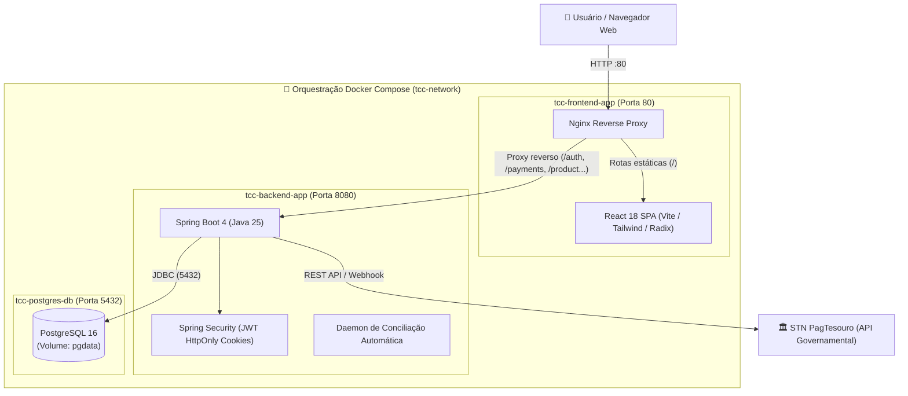

# 🏛️ Modernização de Meios de Pagamento - IFNMG Campus Salinas

<p align="center">
  
  
  
  
  
  
  
  
</p>

Repositório principal do Trabalho de Conclusão de Curso (TCC) de **Caio da Silva Viana**, sob orientação da **Profa. Danielle Miranda Rodrigues**, apresentado ao curso de **Bacharelado em Sistemas de Informação** do **Instituto Federal do Norte de Minas Gerais (IFNMG) - Campus Salinas**.

Este ecossistema automatiza a arrecadação de receitas públicas do campus por meio de pagamentos instantâneos (Pix) e Boleto GRU, integrando-se diretamente à plataforma governamental **PagTesouro** da **Secretaria do Tesouro Nacional (STN)**.

---

## 📑 Sumário

- [Visão Geral da Arquitetura](#-visão-geral-da-arquitetura)
- [Estrutura do Repositório (Submódulos)](#-estrutura-do-repositório-submódulos)
- [Mapeamento de Portas e Serviços](#-mapeamento-de-portas-e-serviços)
- [Pré-requisitos](#-pré-requisitos)
- [Guia de Execução Rápida (Docker Compose)](#-guia-de-execução-rápida-docker-compose)
  - [1. Clonar o repositório com submódulos](#1-clonar-o-repositório-com-submódulos)
  - [2. Configurar variáveis de ambiente](#2-configurar-variáveis-de-ambiente)
  - [3. Subir os containers](#3-subir-os-containers)
  - [4. Acessar a aplicação](#4-acessar-a-aplicação)
- [Comandos Úteis de Operação](#-comandos-úteis-de-operação)
- [Desenvolvimento Local Individual (Sem Docker)](#-desenvolvimento-local-individual-sem-docker)
- [Segurança & Proxy Reverso](#-segurança--proxy-reverso)
- [Licença e Autoria](#-licença-e-autoria)

---

## 🏗️ Visão Geral da Arquitetura

O projeto foi concebido seguindo as melhores práticas de microsserviços e separação de responsabilidades (Frontend SPA + Backend REST API + Banco Relacional), orquestrados de forma transparente via Docker Compose com Nginx como Gateway/Proxy Reverso.



---

## 📂 Estrutura do Repositório (Submódulos)

Este repositório consolidado conecta dois submódulos independentes versionados no GitHub:

| Componente | Diretório | Tecnologias Principais | Repositório |
| :--- | :--- | :--- | :--- |
| **Backend API** | [`server/`](file:///e:/github/TCC/server) | Java 25, Spring Boot 4, Flyway, Spring Security, JPA/Hibernate | [tcc-server](https://github.com/CaioSilvaCsv/tcc-server) |
| **Frontend Web** | [`web/`](file:///e:/github/TCC/web) | React 18, TypeScript, Vite, Tailwind CSS, Lucide Icons, Radix UI | [tcc-web](https://github.com/CaioSilvaCsv/tcc-web) |
| **Orquestração** | `docker-compose.yml` | Docker Compose v2, Nginx Alpine, PostgreSQL 16 | [TCC (Root)](https://github.com/CaioSilvaCsv/TCC) |

---

## 🔌 Mapeamento de Portas e Serviços

Ao iniciar os serviços com o Docker Compose, as seguintes portas estarão disponíveis na máquina hospedeira:

| Serviço | Container | Porta Local | Descrição |
| :--- | :--- | :--- | :--- |
| **Web Frontend** | `tcc-frontend-app` | `http://localhost` (:80) | Interface principal da aplicação (SPA React servida via Nginx) |
| **Backend REST API** | `tcc-backend-app` | `http://localhost:8080` | Endpoints da API REST Spring Boot |
| **Swagger UI** | `tcc-backend-app` | `http://localhost:8080/swagger` | Documentação interativa OpenAPI dos endpoints |
| **PostgreSQL** | `tcc-postgres-db` | `localhost:5432` | Banco de dados relacional (`tcc_db` / `tcc_user`) |

---

## 📋 Pré-requisitos

Antes de iniciar, certifique-se de ter instalado na sua máquina:

* [Git](https://git-scm.com/) (versão 2.30 ou superior)
* [Docker Desktop](https://www.docker.com/products/docker-desktop/) ou Docker Engine com o plugin Docker Compose v2 ativado.

---

## 🚀 Guia de Execução Rápida (Docker Compose)

### 1. Clonar o repositório com submódulos

Clone o repositório principal utilizando o parâmetro `--recurse-submodules` para baixar automaticamente o código do frontend e do backend:

```bash
git clone --recurse-submodules https://github.com/caiosilvacsv/TCC.git
cd TCC
```

> [!NOTE]
> Se você já clonou o repositório sem a flag recursiva, inicialize os submódulos executando:
> ```bash
> git submodule update --init --recursive
> ```

---

### 2. Configurar variáveis de ambiente

1. Copie o arquivo `.env.example` da raiz para `.env` (opcional, para portas e banco):
   ```bash
   cp .env.example .env
   ```
2. Configure as variáveis do backend criando o arquivo `.env` dentro da pasta `server/`:
   ```bash
   cp server/.env.example server/.env
   ```
3. Edite `server/.env` preenchendo as chaves do **PagTesouro**, credenciais de e-mail (SMTP) e chave de assinatura JWT (`JWT_SECRET`).

---

### 3. Subir os containers

Execute o comando unificado para compilar e iniciar todos os serviços em segundo plano:

```bash
docker compose up --build -d
```

O Docker Compose cuidará de:
1. Inicializar o PostgreSQL e aguardar o `healthcheck` de prontidão.
2. Compilar o backend Spring Boot com Maven e iniciar a API.
3. Compilar a SPA React com Vite e iniciar o Nginx como servidor web e proxy reverso.

---

### 4. Acessar a aplicação

* **Aplicação Web:** Abra no navegador [http://localhost](http://localhost)
* **Documentação Swagger:** Acesse [http://localhost:8080/swagger](http://localhost:8080/swagger)
* **Auditoria do Banco de Dados:** Conecte seu cliente SQL preferido (DBeaver, DataGrip, pgAdmin) em `localhost:5432` com usuário `tcc_user` e banco `tcc_db`.

---

## 🛠️ Comandos Úteis de Operação

| Ação | Comando |
| :--- | :--- |
| **Visualizar logs em tempo real** | `docker compose logs -f` |
| **Ver logs de um serviço específico** | `docker compose logs -f server` ou `docker compose logs -f web` |
| **Verificar o status dos containers** | `docker compose ps` |
| **Parar todos os serviços** | `docker compose stop` |
| **Parar e remover containers e redes** | `docker compose down` |
| **Parar e remover incluindo volumes (limpar banco)** | `docker compose down -v` |
| **Reconstruir as imagens sem cache** | `docker compose build --no-cache` |

---

## 💻 Desenvolvimento Local Individual (Sem Docker)

Se preferir executar o frontend ou o backend diretamente na máquina sem containers para desenvolvimento ativo e depuração com hot-reload:

### Backend (`server/`)
Consulte a documentação completa em [`server/README.md`](file:///e:/github/TCC/server/README.md) e [`server/DOCUMENTACAO_SERVER.md`](file:///e:/github/TCC/server/DOCUMENTACAO_SERVER.md).
* Requer Java 25 e PostgreSQL rodando localmente.
* Executar via terminal: `./mvnw spring-boot:run` ou pela sua IDE (IntelliJ IDEA / VS Code / Eclipse).

### Frontend (`web/`)
Consulte a documentação completa em [`web/README.md`](file:///e:/github/TCC/web/README.md).
* Requer Node.js 20+.
* Instalar dependências: `npm install`
* Iniciar servidor de desenvolvimento: `npm run dev`

---

## 🛡️ Segurança & Proxy Reverso

A arquitetura com Nginx embutido no container frontend resolve pontos críticos de segurança em produção:

1. **Eliminação de CORS:** As requisições para a API são feitas no mesmo domínio e porta (`http://localhost/auth`, `/payments`, etc.) e redirecionadas internamente para `http://server:8080`.
2. **Cookies HttpOnly & Lax:** Os tokens de sessão JWT são gravados exclusivamente em cookies `HttpOnly` com flag `SameSite=Lax`, blindando a aplicação contra ataques XSS e CSRF.
3. **Encaminhamento de Cabeçalhos Reais:** O Nginx repassa os cabeçalhos `X-Forwarded-For` e `X-Forwarded-Proto`, permitindo ao Spring Boot identificar os IPs de origem e auditoria com precisão.

---

## 👥 Licença e Autoria

* **Autor:** Caio da Silva Viana
* **Orientadora:** Profa. Danielle Miranda Rodrigues
* **Instituição:** [IFNMG - Campus Salinas](https://www.ifnmg.edu.br/salinas)
* **Curso:** Bacharelado em Sistemas de Informação
* **Finalidade:** Trabalho de Conclusão de Curso (TCC)
